# 全球资源运营系统

面向跨市场品牌团队的 KOL、媒体与创作者运营工作台：从发现资源、制定投放计划，到项目协作、内容追踪和效果复盘，把分散在表格、社媒平台与沟通工具里的信息连接起来。

> 这是项目与技术实现介绍，不是可公开访问的演示账号。截图用于展示产品界面，数据随时间变化；公开仓库不提供生产环境账号、联系人或凭证。

## 产品解决什么问题

海外达人营销往往跨国家、平台、团队和供应商。资源资料重复维护、账号数据口径不一、邀约与交付进度散落在聊天记录里，投放结束后也难以把内容表现与成本关联。本系统用“资源主档 + 项目执行 + 内容数据 + 分析推荐”的结构，帮助团队形成可复用的运营资产。

| 运营环节 | 平台能力 | 对团队的价值 |
| --- | --- | --- |
| 找人 | 全球资源库汇集达人与媒体档案、平台账号、市场/领域标签和近期表现 | 跨市场筛选、对比候选资源，减少重复搜集 |
| 定策略 | 大模型结合需求、市场、平台、预算和资源事实，选择候选并解释推荐依据 | 加快初筛，把推荐转成可执行的项目候选池 |
| 做投放 | 项目管理关联合作资源、内容、执行阶段、预算和负责人 | 统一推进邀约、议价、交付与发布 |
| 看效果 | 内容资产与项目报告追踪曝光、互动、CPM 等指标 | 对比资源和平台表现，为下一轮投放提供依据 |
| 沉淀经验 | 标签、治理规则与数据同步连接资源档案和合作历史 | 让一次合作的经验可被后续项目复用 |

### 与社媒、海外达人运营和增长的关系

这不是单一的“达人名单”工具，而是围绕社媒与海外投放的协同系统：团队可以从不同市场和平台识别合适的创作者，在项目中组织合作与内容发布，再按内容表现和成本做复盘。对增长团队而言，它提供的是**选人、执行、衡量和迭代的基础设施**，便于持续优化内容触达、互动效率和预算分配；实际销量、获客或 ROI 仍取决于归因数据、渠道策略与具体执行，不应由平台界面直接推断。

## 核心模块

### 项目管理：把 Campaign 变成可追踪的执行流程

项目列表展示合作资源、内容量、曝光/播放、互动率、目标市场和对接人，并支持搜索、导入与进入项目。项目详情按“概览—达人/媒体—内容”组织：概览查看内容、平台效果及执行信息；达人/媒体页管理合作对象与合作阶段；内容页关联发布作品及其数据。预算、效果报告和项目信息与执行页相连，便于从单条内容追溯到项目结果。导入模板支持将既有项目数据迁入，减少从零录入。

项目概览汇总内容、合作资源、曝光互动、成本效率与平台表现：

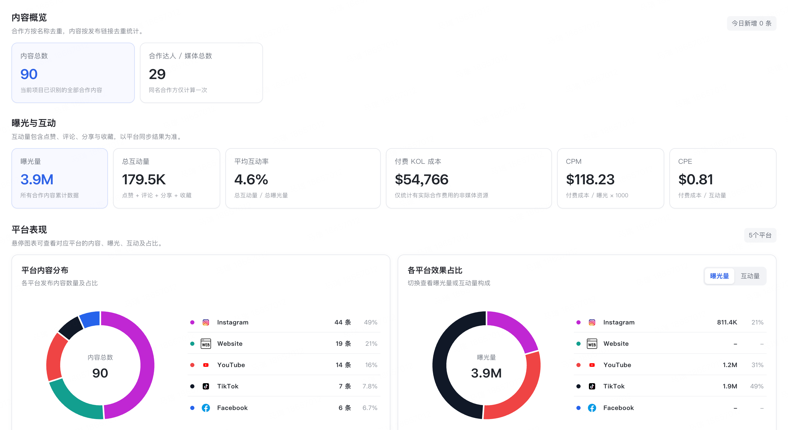

项目详情的达人/媒体页展示合作资源、粉丝量、内容数量、曝光、互动与 CPM：

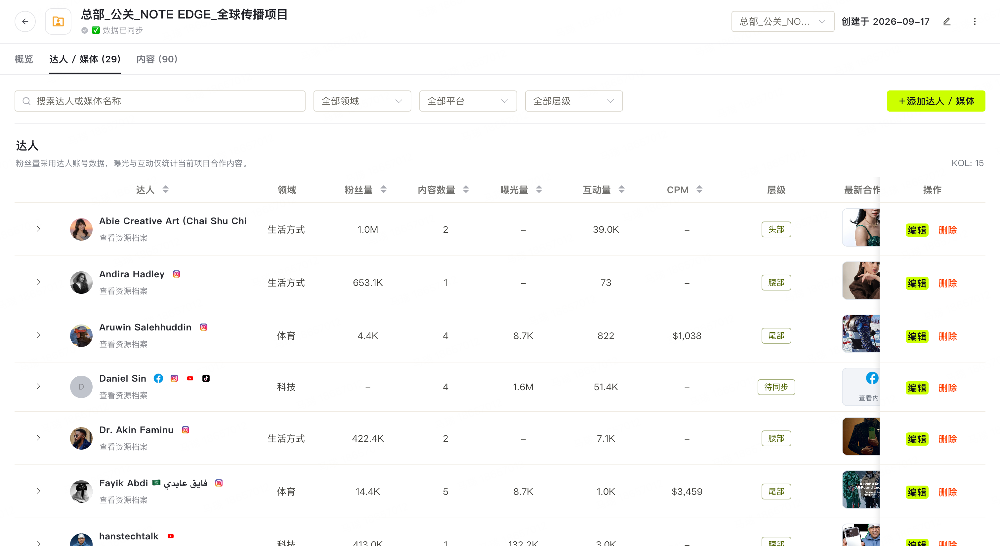

项目详情的内容页（关联社媒发布作品与内容表现）：

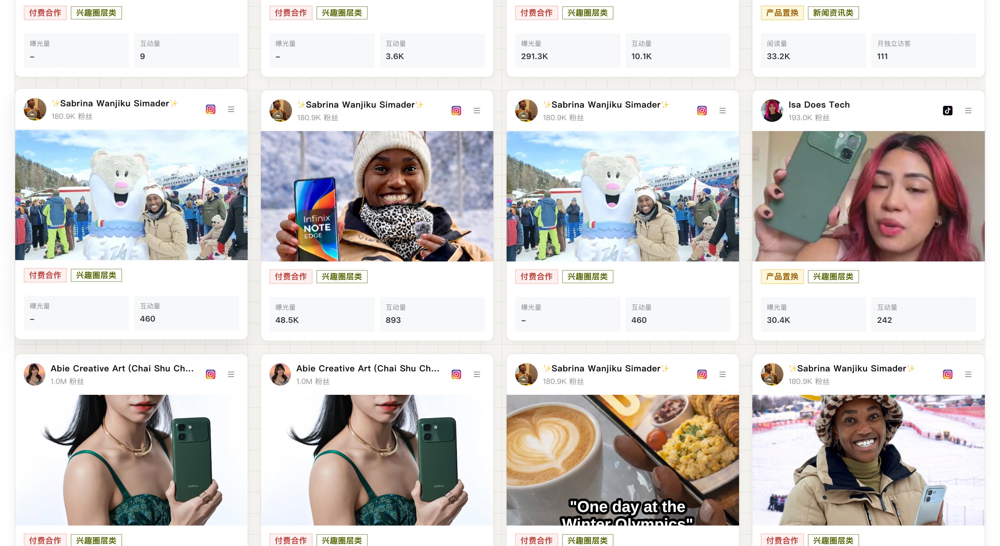

### 全球资源库：可复用的达人与媒体主档

资源库提供名称、账号、类型、国家/地区、粉丝量等筛选入口，集中展示平台账号、基础表现、合作数据与近期作品。资源档案进一步查看平台维度指标、内容表现和合作历史。资源不只属于一次 Campaign：项目合作结束后，档案和历史表现仍可为下一轮选人服务。

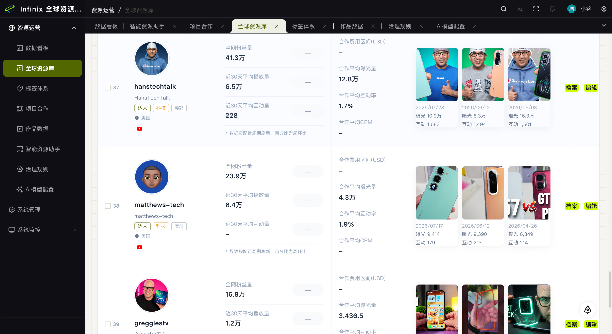

资源档案展示单个创作者的平台指标与近期作品：

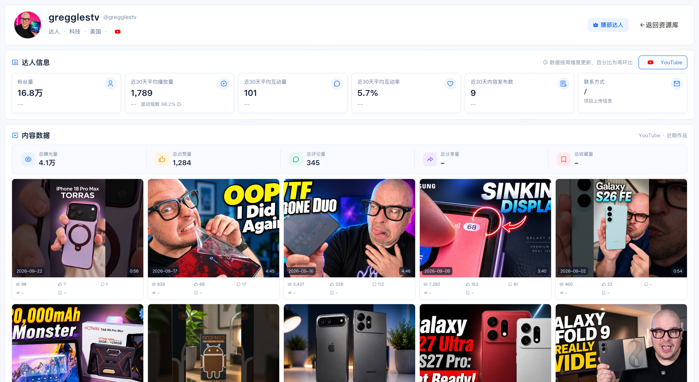

### 数据看板

数据看板按市场、资源类型和平台观察资源覆盖、内容资产、曝光、互动以及创作者表现，为选人与投放复盘提供同一套数据入口。

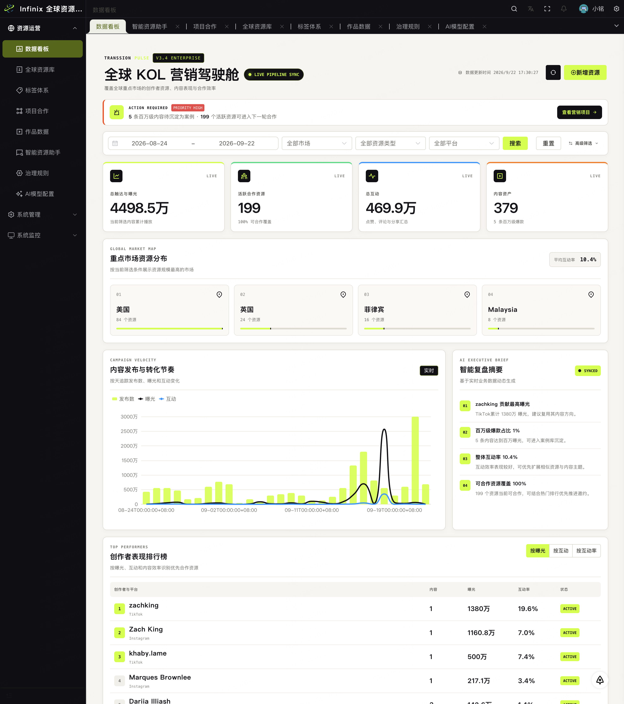

### AI 达人 / 媒体推荐：从推广需求到真实候选

默认入口统一为 **AI 推荐**。用户只需描述“寻找面向伊拉克市场的手机科技达人，用于智能手机测评与新品推广”，无需选择采集平台、输入搜索词或提前准备达人名单。后台大模型分析需求，生成当地语言与英语检索词；采集真实公开资料和最近作品后，再由大模型选择候选、评分并说明理由。推荐先展示为“待核实”，运营人员看过证据后再确认入库。

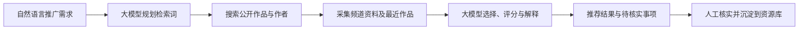

#### 统一入口怎么操作

1. 在 **资源运营 → 达人/媒体 AI 推荐 → AI 推荐** 输入推广需求，点击 **生成推荐**。
2. 页面自动显示寻找候选、读取公开资料和模型分析的进度，完成后展示推荐；平台仅作为每位达人的来源信息。
3. 查看模型评分、推荐理由、平台公开数据和作品，点击 **查看证据并核实入库**；所在地与受众地域分别判断，报价、档期和品牌安全仍需核实。
4. 核实所在地、语言、内容方向并填写证据，可补充行业、资源领域和已有资源标签后确认入库。同一平台账号按稳定 ID 复用已有档案，已有业务资料保留、空字段补齐、标签合并；入库后仍可继续查看推荐。
5. **已保存的寻找条件** 保留库内推荐、保存条件、合作建议和加入 Campaign 的原有流程。

**真实验收**：2026-10-22 在本地已登录页面只提交上述自然语言需求，后台实际调用配置的 `OpenAI/gpt-5` 规划检索词，经 YouTube Data API 采集 **12 位候选、72 条最近作品**，再调用大模型自动生成推荐。当时没有对本轮候选执行任何入库操作，推荐已经展示。页面及数据库的来源为 `ai`、`modelInvoked=true`、`fallback=false`。此前同一实现的人工核实流程已将 iMAD Tech、Mohammed Alhaddad 与 Tech Time H&M 的真实资料及 18 条作品写入资源库，未使用 Mock 数据。

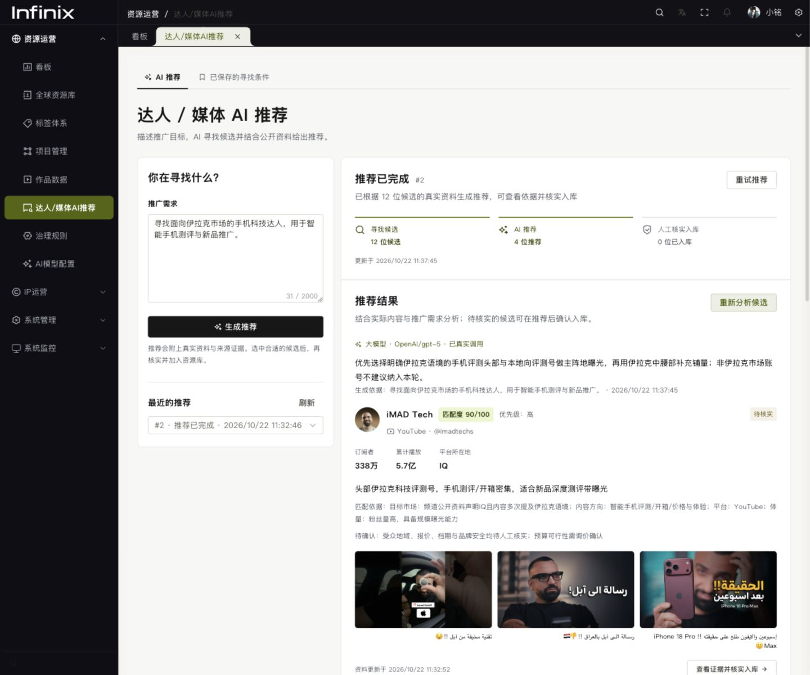

随后基于同一批真实候选重新分析，模型返回 **4 位推荐**：iMAD Tech、Mohammed Alhaddad、Hamadaalmansoor 与 بوعلي Tech，匹配分分别为 90、86、73、58；分数是本次模型判断。核实 iMAD Tech 后复用已有档案，数据库中同频道仍只有一条资源，4 位推荐继续保留。

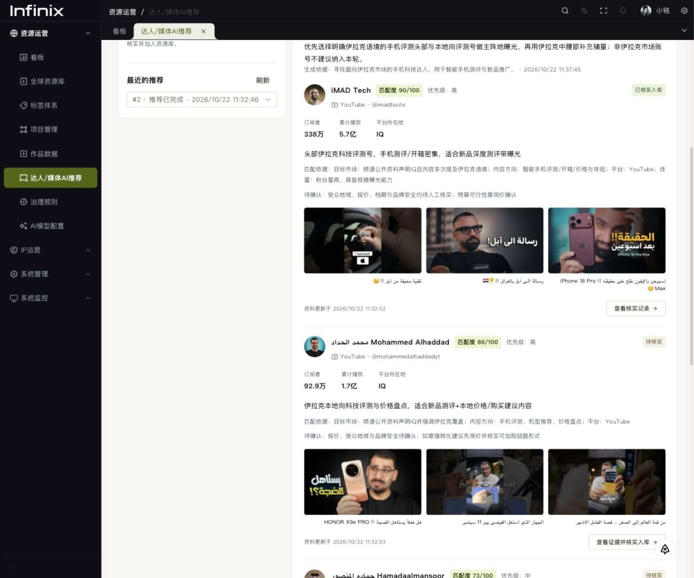

#### 入库后与全球资源库保持一致

核实抽屉使用资源库的行业、领域与标签，确认后可回看原核实记录。头像同时保留展示地址与来源地址；达人层级沿用资源库受众量规则，与业务评分的 A–D 等级分开。复用已有档案时保留已维护字段，只补空值并合并标签。

2026-10-22 的字段对齐验收使用上述真实采集资料：修复并补全 iMAD Tech、Mohammed Alhaddad、Tech Time H&M 三条旧档案，再从实际模型推荐中核实 **Hamadaalmansoor**，生成资源 **#990148** 和6条作品。四位达人共24条已采集作品；行业为「消费电子」、领域为「科技」、资源标签为「消费电子 / 测评」，均依据频道简介与已采集手机评测内容人工确认。新候选重新打开核实记录后字段仍完整，频道身份只有一条资源记录。

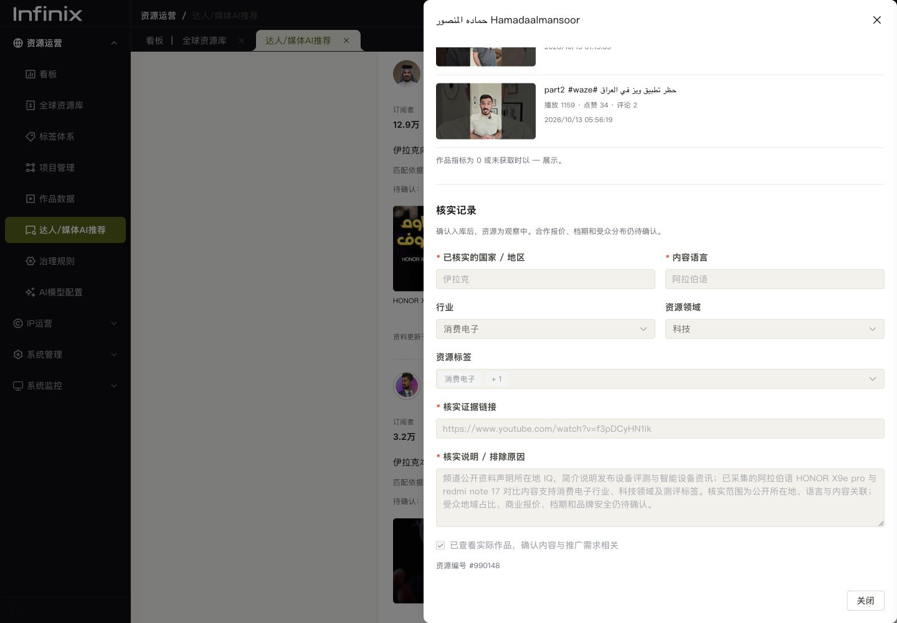

列表和档案使用同一近30天作品样本计算，验收值与数据库逐条汇总一致：

| 真实达人 | 层级 | 频道总视频数 | 已采集 / 近30天样本 | 样本平均播放 | 样本平均互动 | 样本互动率 |
| --- | --- | ---: | ---: | ---: | ---: | ---: |
| iMAD Tech | 头部 | 1,198 | 6 / 6 | 227,152.67 | 7,185.33 | 3.16% |
| Hamadaalmansoor | 腰部 | 567 | 6 / 6 | 2,746.17 | 88.17 | 3.21% |

这些均值是近30天内发布且已采集作品的当前累计计数均值，不代表全频道30天完整表现或这30天新增播放。无样本时显示「未知」，真实零播放仍纳入均值；旧手填指标保留为「口径未核实」，不混入样本统计。资源标签与从作品文本提取的内容主题分开展示。

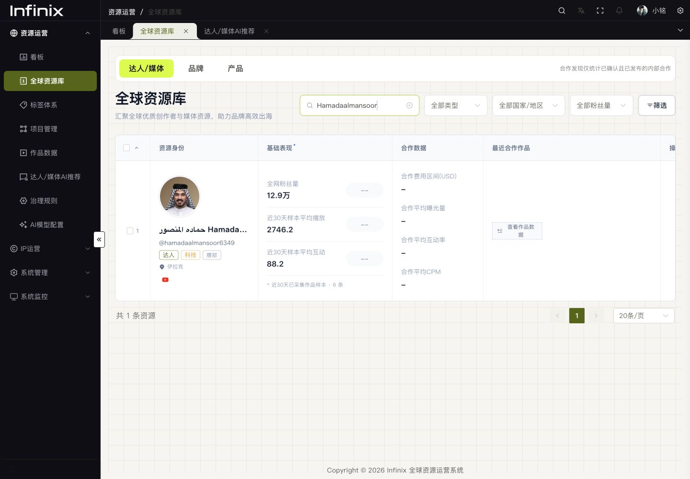

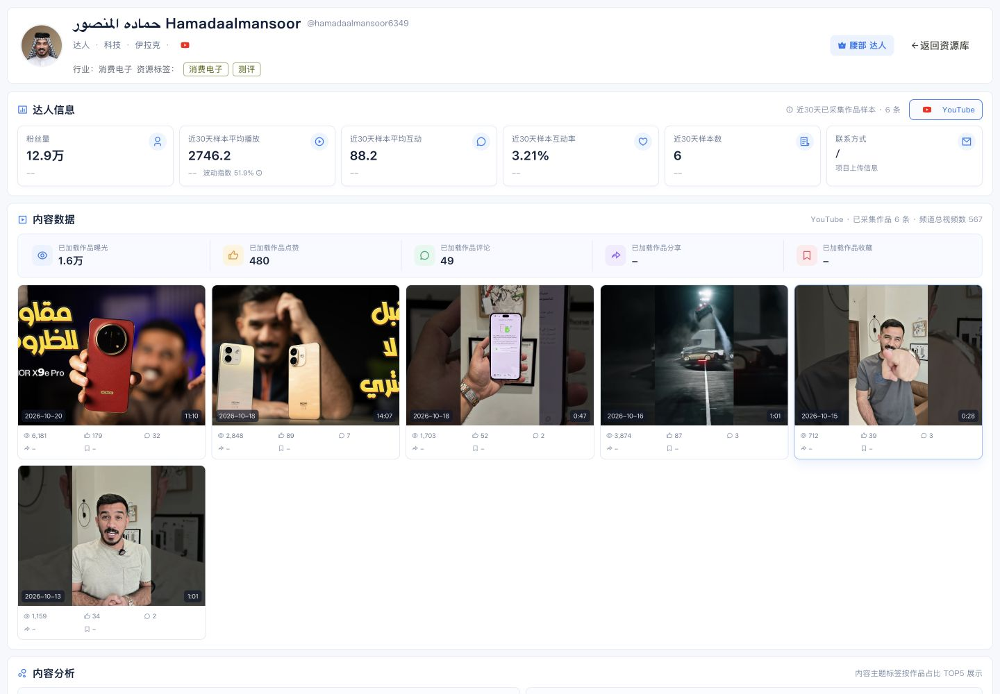

| 实现环节 | 当前机制 | 代码入口 |
| --- | --- | --- |
| 需求规划 | 配置的大模型生成 1–3 条检索词，严格校验结构；用户无需填写关键词，失败不使用固定关键词兜底 | [`creator_discovery_planner.go`](./backend/cmd/server/creator_discovery_planner.go) |
| 真实采集 | 搜索作品发现作者，按频道 ID 去重，读取公开资料及最近 6 条作品，保存来源和时间；缺失数据保持未知 | [`creator_discovery_youtube.go`](./backend/cmd/server/creator_discovery_youtube.go) |
| 自动推荐 | 新发现的待核实候选直接交给模型，排除已拒绝及库内不可合作资源，输出必须命中本轮候选 ID；失败保留原因 | [`creator_discovery.go`](./backend/cmd/server/creator_discovery.go) |
| 人工沉淀 | 用户归属及资源页权限校验，证据关联验证，事务内去重复用档案与作品；头像、行业、领域、标签及达人层级对齐全球资源库 | [`creator_discovery_import.go`](./backend/cmd/server/creator_discovery_import.go) |
| 统计口径 | 列表与档案统一读取近30天已采集作品样本；展示样本数，区分频道总视频数与已采集作品数，无样本均值显示未知 | [`resource_metrics.go`](./backend/cmd/server/resource_metrics.go) |

**当前范围**：统一入口目前接入的公开发现数据源是 YouTube，尚不代表全平台或全网覆盖。频道声明国家不等于受众地域，模型匹配分也不代表投放效果。任务采用单进程后台 worker，部署前需执行 `055_creator_discovery.sql`、`056_creator_discovery_resource_alignment.sql` 并配置平台 API 与模型；配置、重启恢复和并发限制见 [后端部署说明](./backend/README.md#ai-creator-discovery-and-recommendation)。

#### 已保存的寻找条件与 Campaign 候选池

在「已保存的寻找条件」中，运营人员用自然语言描述推广需求，再补充目标市场、资源类型、平台与预算。系统从已有资源库召回候选，把资源资料和项目约束交给配置的大模型，生成**候选选择、匹配评分、推荐理由与风险提示**；保存寻找条件后，还可查看合作场景与完整建议。运营人员核对档案、勾选资源，再批量加入 Campaign，继续邀约与合作执行。

这项能力展示的是 **AI 与业务系统的连接**：输入来自真实业务条件，输出受资源库约束，并能进入已有项目流程。达人 / 媒体推荐只展示通过校验的大模型结果；模型未配置、调用失败或没有有效输出时明确报错，不回退为规则推荐。

#### 怎么操作

前置条件：管理员在 **AI 模型配置** 中启用模型和推荐功能，填写模型名及服务地址；密钥通过服务端 `ai_model.api_key` 配置。当前账号需要推荐页和目标项目的相应权限。

1. 在 **资源运营 → 达人/媒体 AI 推荐 → 已保存的寻找条件** 输入推广需求，按需填写市场、类型、平台和预算，点击 **生成推荐**。
2. 查看「AI 排序」评分、匹配依据及风险提示，切换达人 / 媒体分类，进入资源档案核对平台表现、作品与合作记录。
3. 点击 **保存寻找条件**，为需求命名。保存结果包含合作建议和适用场景，可展开查看，也可通过条件菜单 **立即更新**。
4. 勾选候选、选择 Campaign，点击 **加入 Campaign**；在项目的达人 / 媒体页继续管理合作。
5. 保存的条件支持暂停和恢复。后台每周一 09:00（北京时间）后检查已启用的条件，有新匹配时写入站内通知；这项定时机制由后台实现，本次演示没有等待周检触发。

以下截图来自 **2026-10-21 线上系统的实际操作**，候选资料、头像、作品和指标均来自现有业务资源库，推荐与合作建议实际调用配置的大模型生成。输入「我想在伊拉克做推广手机」得到 8 位即时候选；随后明确选择「伊拉克」市场并保存条件，独立的保存推荐流程返回 9 位候选，接口中推荐来源和建议来源均为 `ai`。本次未设置预算上限，界面的 `0` 表示不限制预算，未知报价仍需询价。操作后已暂停本次创建条件的自动周检；模型评分不代表已验证的投放效果。

**需求 → 推荐结果**：自然语言与结构化条件共同进入推荐流程，返回模型选择的候选和可读的匹配依据。没有真实报价的候选显示费用待确认，预算仍交给模型参考，不使用粉丝数或资源等级推算价格来提前排除资源。

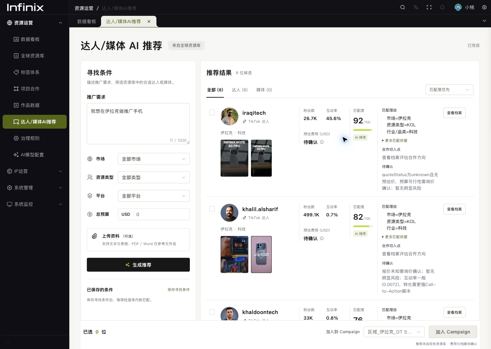

**保存条件 → 合作建议 → 人工选择**：明确选择「伊拉克」市场后保存条件，展开 master.techno 的模型合作建议，勾选候选并选择目标 Campaign。即时推荐和保存推荐分别调用模型，候选与评分可能不同。

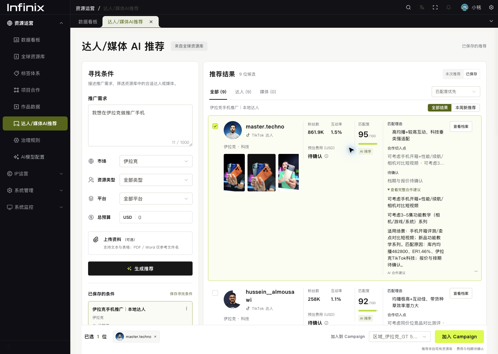

**目标 Campaign → 项目执行**：下图为所选真实项目「区域_伊拉克_GT 50 Pro_新品上市传播项目」原有的 8 位合作达人及内容表现。本次线上操作完成候选选择与目标项目核对，未点击「加入 Campaign」写入新的正式合作关系；加入功能的接口与前端接线见下方实现说明。

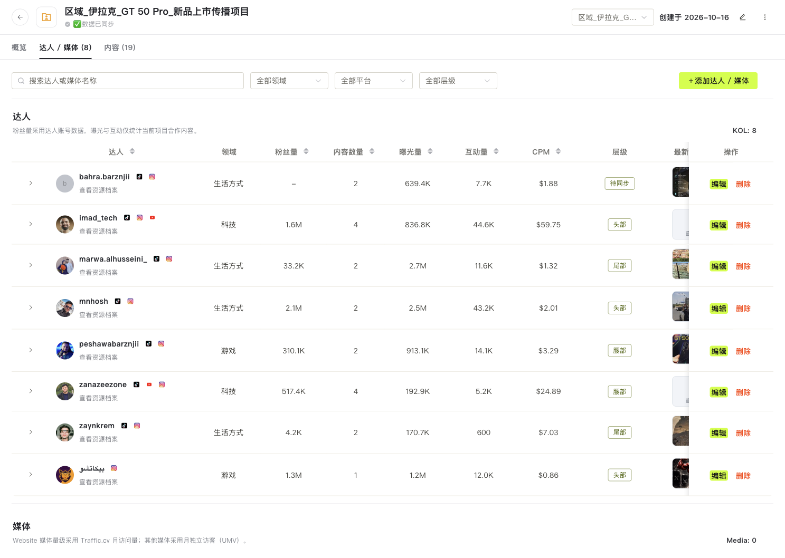

#### 怎么实现

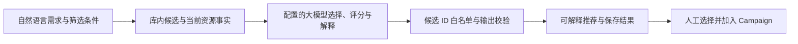

| 实现环节 | 当前机制 | 代码入口 |
| --- | --- | --- |
| 模型接入与即时推荐 | 服务端读取模型配置和凭证，调用兼容 Chat Completions 的接口；发送需求与候选事实，解析结构化输出；多类型/多平台需求保留候选范围，显式筛选条件优先 | [`business.go`](./backend/cmd/server/business.go) |
| 输出与来源校验 | 只接受候选池中的真实 ID，验证模型评分和理由；保存推荐还要求有效的模型合作建议，不用未被模型选择的规则候选补齐数量 | [`creator_recommendation_test.go`](./backend/cmd/server/creator_recommendation_test.go)、[`recommendations.go`](./backend/cmd/server/recommendations.go) |
| 保存、更新与通知 | 按用户保存寻找条件与结果，保留模型评分及建议来源；核对当前资源状态和事实，失效结果需重新生成；周检运行与新匹配通知去重 | [`recommendations.go`](./backend/cmd/server/recommendations.go) |
| 工作台与项目连接 | Vue 工作台负责筛选、档案查看和候选选择，调用已有项目接口批量加入 Campaign，并保留失败项供重试 | [`assistant/index.vue`](./vue-pure-admin/src/views/business/assistant/index.vue)、[`RecommendationWorkbench.vue`](./vue-pure-admin/src/views/business/assistant/RecommendationWorkbench.vue) |

**库内推荐边界**：「已保存的寻找条件」的推荐范围是已有资源库；模型密钥保留在服务端。预算是业务约束，没有真实报价时需询价确认。文本与表格可提供资料摘要，PDF / Word 当前仅参考文件名。品牌适配、档期、报价、授权与最终合作仍由运营人员核实；本节不将这些能力外推为已验证的营销增长或自动成交。

### 标签、作品与治理

标签体系为资源和内容提供统一分类；作品数据连接社媒内容与资源/项目；治理规则和模型配置帮助维护数据口径、评分与推荐策略。它们共同支撑跨市场协作，而不仅是增加后台菜单。

## 从 AI 初创公司视角看

这个项目的产品价值，在于为 AI 能力准备了可操作的业务底座，而非只在界面里加入聊天框：

1. **结构化上下文**：资源、平台账号、项目、合作和内容数据彼此关联，使推荐能基于真实约束，而非孤立关键词。
2. **人机协作闭环**：AI 可协助解析需求、筛选候选和解释推荐，运营人员仍负责品牌适配、商务判断与风险复核。
3. **反馈可积累**：投放后的内容表现与合作记录可回流到资源判断中，让下一次选择更有依据。
4. **跨市场可扩展**：统一资源主档和项目流程有利于不同国家、团队及供应商共享工作方式，降低重复建库成本。
5. **可核验的 AI 边界**：候选白名单、输出校验、模型来源与明确错误状态，让运营人员知道哪些结果来自模型、哪些条件仍待商务确认；达人 / 媒体模块不会用规则结果掩盖模型失败。

这些是基于当前功能设计与实现的优势，不代表已经验证了商业收入、推荐准确率或增长提升；这些结果需要在真实投放中持续测量。

## 技术组成

- 前端：Vue 3、TypeScript、Vite、Element Plus，位于 [`vue-pure-admin`](./vue-pure-admin)。
- 后端：Go + MySQL，提供认证、业务 API、同步与推荐编排，位于 [`backend`](./backend)。
- 数据采集与同步：独立采集插件/服务与平台 API 接入，位于 [`collector-plugins`](./collector-plugins) 和 [`collector-services`](./collector-services)。
- 详细组件边界见[系统架构说明](./docs/system-architecture.md)，产品需求背景见[PRD](./PRD.md)。

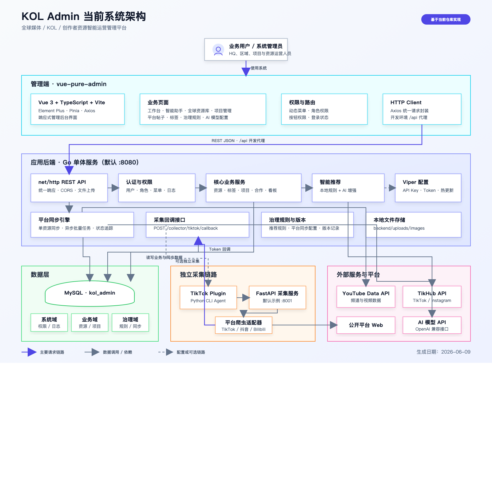

## 本地开发

先按 [`backend/README.md`](./backend/README.md) 配置 MySQL、迁移与后端运行环境，再启动前端：

```bash
cd vue-pure-admin
pnpm install
pnpm dev
```

前端开发环境默认通过 `/api` 代理到本机后端。生产部署需要单独配置数据库、SSO、平台 API 与模型密钥；不要将凭证、联系人、合同报价或数据库导出提交到公开仓库。

## 截图与数据说明

文中截图仅代表拍摄时的界面状态。项目与资源库截图包含项目名称、创作者公开资料、运营指标、付费 KOL 成本及部分 CPM/CPE；AI 推荐章节分别使用本地真实平台采集、线上真实资源库、实际模型输出和已有 Campaign，未使用 Mock 资源或测试项目。本文不展示联系人、凭证、单人合同价格或完整生产预算；更完整的业务数据应在经授权的环境查看。
