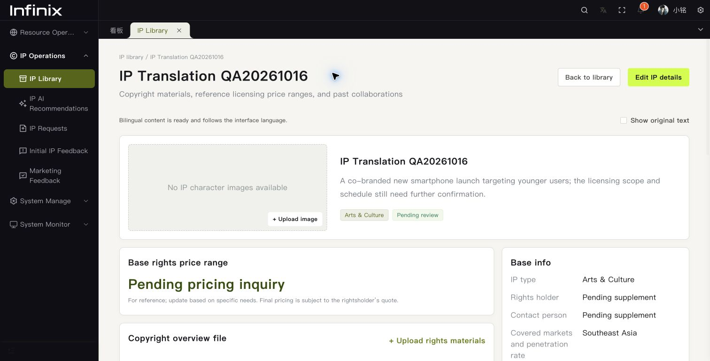
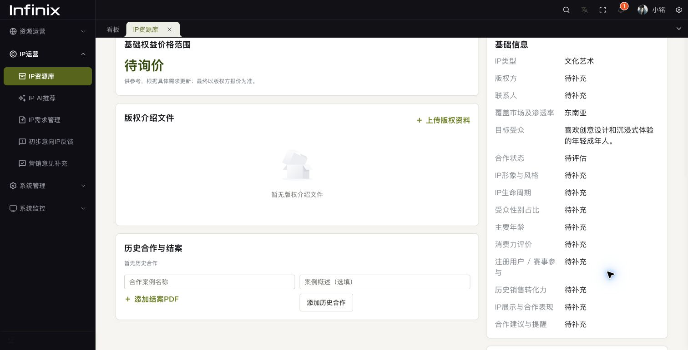

# IP 录入内容中英互译

保存或提交 IP 资料、需求、IP 意见及 IMC / 品牌 / 用户 / 媒介 / PR 意见后，服务器自动把中文叙述生成英文译文，把英文叙述生成中文译文。同一条记录可混合中英文。原字段保持不变，编辑始终使用录入原文；只读列表和详情按界面语言选用译文，未完成时显示原文。详情支持“查看录入原文”、查看进度和失败重试。

覆盖 IP 名称、介绍、版权方、受众、画像、许可说明、合作案例，需求项目与背景描述、补充说明、库外推荐理由、候选评价、IP 评估和各职能营销意见。不翻译人员与联系方式、员工编号、金额与评分、日期、规范枚举、附件内容与文件名、历史对话。专有 IP / 品牌名称要求模型保留，不虚构官方译名、授权事实或合作条件。

资源录入页“保存草稿”仅保存在浏览器，创建或更新到服务器后才触发翻译；需求和意见的服务器草稿也会翻译。历史记录不会批量自动重翻，可在详情点击重试补齐。已完成且原文未改变的字段复用缓存。

## 实现与部署

- 复用迁移 `035_resource_localization.sql` 的 `biz_localized_texts` 表，无需新增表或字段。部署前确认原有迁移已执行，前后端一起发布。
- 复用现有 AI 模型配置与 `config.yaml` 中的模型密钥；没有密钥时仍可保存原文，页面提示尚无译文。无需前端密钥或额外翻译供应商。
- 保存时按字段白名单将任务写入数据库，后台每 3 秒领取待翻译任务，按目标语言分批调用模型。翻译不阻塞保存操作；失败保持原文并支持手动重试。
- 缓存按实体、字段、目标语言及原文哈希匹配。领取、提交结果都校验原文版本；修改后不会应用旧译文。处理前重新检查源记录，已删除或移除的内容不发给模型。处理进程中断后，超过 5 分钟的任务可重新领取。
- `POST /business/ip/translations/status` 复用对应 IP 菜单权限，返回翻译元数据。前端轮询只更新译文，不重新加载意见表单，不覆盖用户正在填写的内容。
- 此功能生成界面展示译文；业务原文、搜索和导出底层数据继续使用原始字段。模型不可用或输出不完整时不伪造译文。

## 验收（2026-10-16）

- 配置的真实模型与隔离 MySQL 数据库测试通过：中英两个方向、原文保留、未修改缓存复用、修改原文语言、需求描述、IP 评估及独立营销职能意见。
- 自动用例覆盖错误模型返回、旧版本结果、防止已删除内容发给模型、嵌套 JSON / 数组展示、原文切换和状态更新不覆盖表单。
- 原系统 Chrome `localhost:8848` 验收：录入混合中英文，后台生成完成，中英文列表 / 详情按语言展示，原文切换，编辑保留原始输入。
- 英文页面在 640px 下提示条正常换行，文档宽度与视口均为 640px；前后端测试、race 检查、类型检查、词典检查、ESLint / Stylelint 和生产构建通过。
- 仅创建并清理本轮临时验收资料与隔离测试库，没有发送飞书测试消息。

