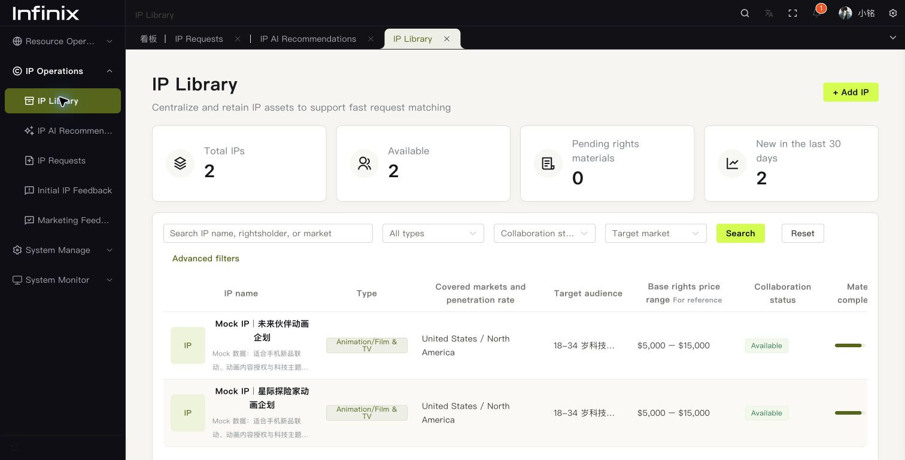
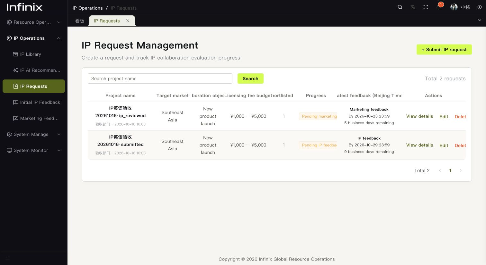
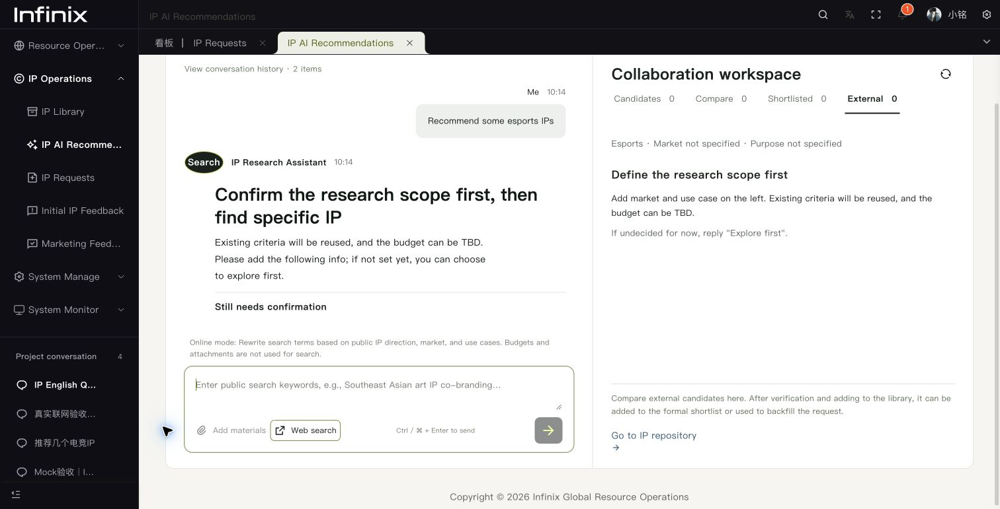

# IP 中英双语

通过原系统右上角语言菜单切换 English。IP 资源库、需求管理、IP 意见、五个职能的营销意见、AI 推荐、项目会话、截止时间说明和相关通知界面随语言切换。

- 项目名、IP 名、介绍、录入的评估意见和历史对话保留原文。切换语言不更新业务记录。
- 固定选项只翻译展示标签，提交值沿用原来的枚举，兼容已有数据及筛选。
- 新增 AI 回答、联网追问、流式状态、错误和规则兜底使用当前语言。模型提示保留原始 IP 名、证据引文及规范枚举。
- 英文模式下载 `vue-pure-admin/public/IP-import-template.en.xlsx`。导入兼容中英文表头和固定选项；版权附件同时接受 `ImportID_版权介绍*.pdf` / `ImportID_copyright*.pdf`，案例附件同时接受 `ImportID_结案*.pdf` / `ImportID_case*.pdf`。
- 新保存的需求在 brief 中记录 `notificationLanguage`，供发起人的飞书阶段提醒使用。未记录语言的历史需求沿用中文。无需数据库结构迁移。

## 维护

前端 `src/utils/ipI18n.ts` 只用于系统文案及固定选项，不可包装任意业务正文。新增文案同时维护 `vue-pure-admin/src/locales/ip.en.json` 和后端嵌入的 `backend/cmd/server/data/ip_en.json`；两份词典须保持一致。

前端请求和流式调用通过 `Accept-Language` 向后端传递语言。后端只本地化生成的消息与元数据，不对历史会话或业务字段做递归翻译。前后端需一起部署。

## 验证（2026-10-16）

- `cd vue-pure-admin && pnpm check:ip-locales`：词典一致、占位符、中英文切换、枚举/导入表头、英文工作簿、模板覆盖、对话分流及类型消歧。
- 前端 typecheck、相关 ESLint / Stylelint、生产构建通过。
- `cd backend && go test ./...` 通过；IP 工作流数据库烟测及 locale 用例的 race 检查通过。
- 原系统 localhost:8848 的 Chrome 验收：资源库、新增表单、需求详情、五个职能表单、历史中文保留、英文联网追问；640px 下无横向溢出。
- 使用已配置密钥及指定 gpt-5 端点直接验证真实流式模型调用，返回英文 headline / explanation。浏览器也验证了模型暂不可用时的英文兜底。
- 仅清理本轮 `IP英语验收20261016` / `IP English QA20261016` 临时样例；未发送真实飞书测试消息。

截图：

