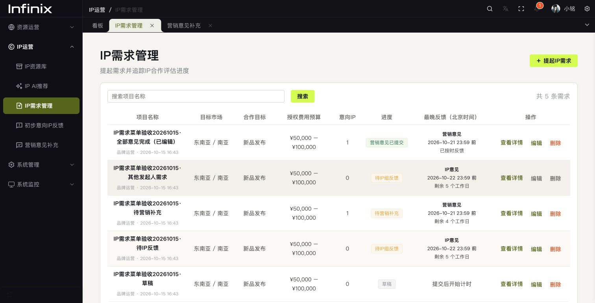

# IP需求列表编辑与删除

IP需求管理列表的固定操作列显示「查看详情 / 编辑 / 删除」。各阶段均允许发起人本人编辑、删除，其他人的记录禁用编辑与删除并显示原因。后端基于登录账号和 `created_by` 再次校验，不依赖前端按钮状态。

编辑已提交的需求使用「保存修改」，保留流程状态、提交时间、IP反馈时间、营销意见及截止时间，不重复触发需求提交提醒。IP组开始保存反馈后，库内意向IP名单及原始候选评估资料保持只读，项目资料、需求说明、预算与对接人仍可修改，避免覆盖评审已补充的候选与意见。草稿及尚无IP反馈的需求可以调整意向IP。

删除需确认，需求、对应IP评估意见、营销意见与历史站内通知在同一事务内清理；资源库IP与AI会话保留。AI会话解除需求关联并关闭订阅。删除操作写入操作日志。

表头、数据与操作按钮统一居中，截止时间的多行内容同步居中。窄屏保留表格横向滚动与固定操作列。

验证包括后端单元测试、真实MySQL集成测试、前端类型检查、ESLint、Stylelint与构建。浏览器验证了各阶段入口、非本人禁用、已完成需求保存、删除确认取消及居中样式；真实数据库测试验证了删除及关联清理，测试不会发送飞书消息。

