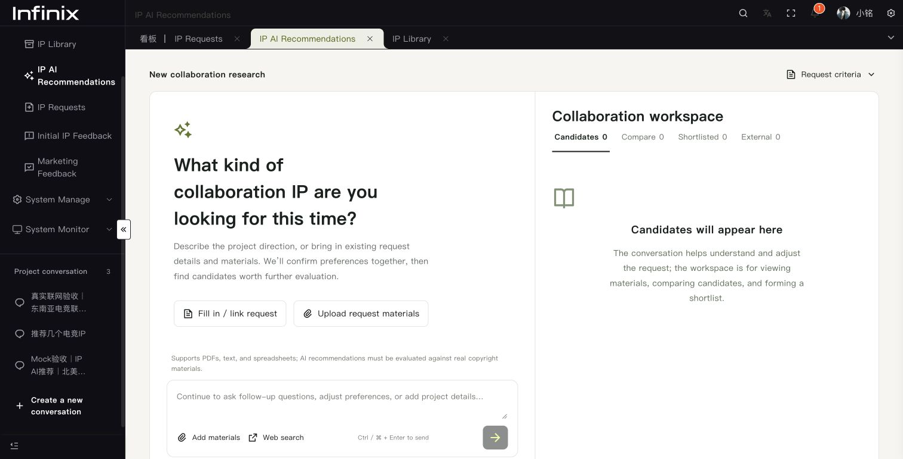
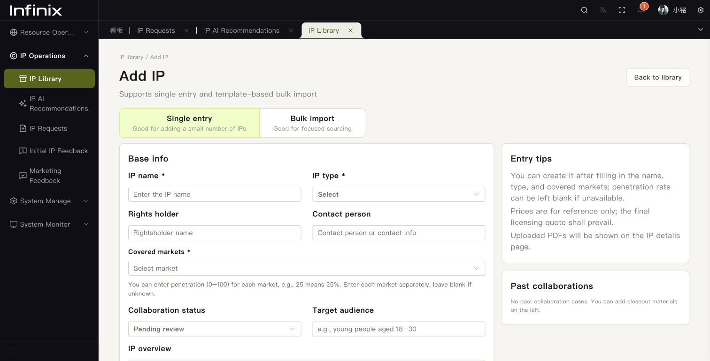
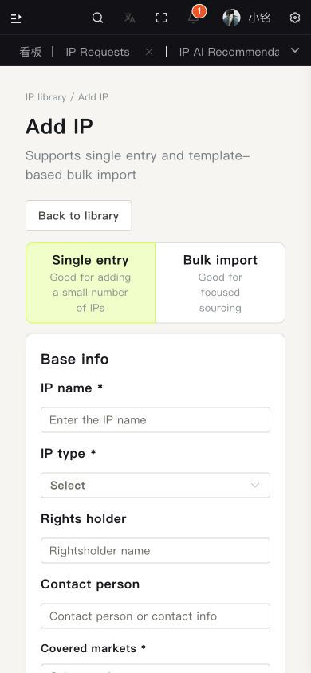
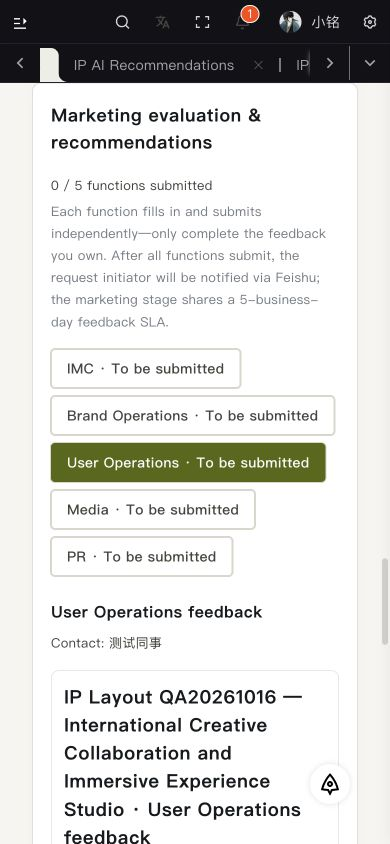
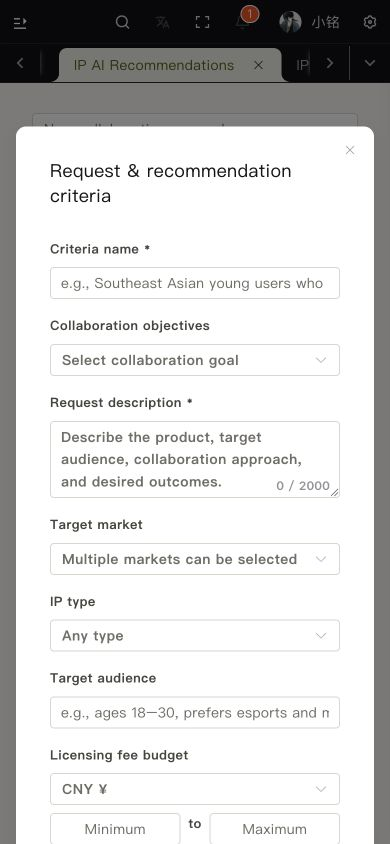

# IP 英文排版适配

本次调整沿用原系统的页面、菜单和工作区结构。

- IP 菜单显示完整名称，按单词换行，高度随内容增长；项目会话最多展示两行，悬浮保留完整名称。折叠菜单和横向菜单沿用既有行为。
- 英文资源录入使用上置标签，输入框获得完整列宽；窄内容区域自动改为单列。中文桌面录入保留原来的侧置标签。
- 筛选栏按可用宽度换行，长下拉选项和已选标签允许换行。表格保留居中表头及独立横向滚动，资源库操作列固定在右侧。
- 需求详情的英文资料标签与值上下排列，长项目/IP 名称正常换行。五个职能按钮、状态、评估字段和提交按钮不依赖中文短文案宽度。
- AI 工作区标签、跟进按钮和上传入口可换行；对比表保持可读列宽并在自身容器内滚动。条件弹窗按视口切为单列；手机预算的币种独占一行，金额范围并排。
- 页面与弹窗提供正确的 `lang` 属性。共享适配样式仅限定 IP 页面、IP 弹窗和 IP 下拉列表。

## 验收

2026-10-16 在原系统 Chrome localhost:8848 验证桌面和 390px 手机宽度，覆盖资源录入、长英文需求、五职能选择器、AI 工作区和条件弹窗。页面宽度未被内容撑开；英文菜单完整显示，长按钮及表单标签未发生内容溢出。所有 `IP Layout QA20261016` 临时数据均在验收后清理，没有发送飞书测试消息。

切换语言实测：桌面中文资源录入标签为原 grid 排列，英文为上置 flex 排列；恢复 English 后界面与表单正常。资源列表实测固定操作列存在，清理后仅保留原有两条资源。

自动检查：前端类型检查、相关 ESLint / Stylelint、多语言校验、生产构建。Impeccable 机械检测未报告问题。

